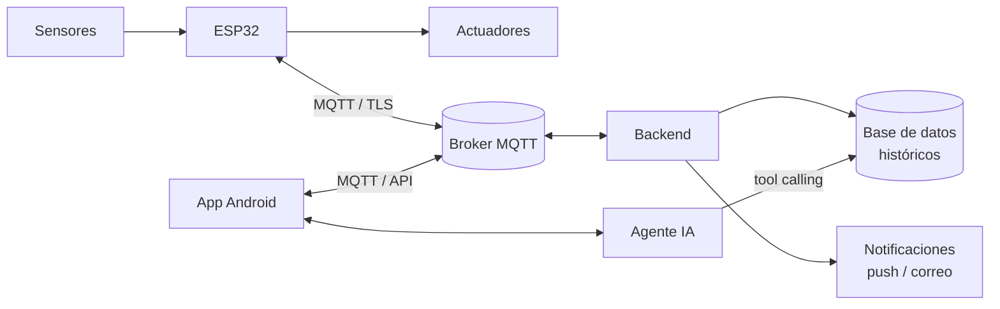

<div align="center">

# Proyecto ESP32 · IoT + App Android + Agente IA

Sistema IoT basado en **ESP32** que monitorea sensores, controla actuadores por **MQTT**, guarda históricos y se opera desde una **app Android** con un **agente de IA** que responde preguntas en lenguaje natural sobre las métricas.

Proyecto formativo · **SENA – Tecnología en Análisis y Desarrollo de Software (ADSO)** · Yopal, Casanare, Colombia


</div>

---

## Arquitectura



## Requisitos del proyecto

- ESP32 DevKit v1 (38 pines) con mínimo **3 sensores** y **2 actuadores**.
- Comunicación por **MQTT** (HiveMQ Cloud, EMQX o Mosquitto).
- App Android instalable (**APK**) para monitoreo y control.
- **Agente IA** dentro de la app que consulta el histórico ("¿cuál fue la temperatura promedio hoy?").
- **Notificaciones** push (FCM / ntfy) y/o correo.

## Estructura del repositorio

| Carpeta | Contenido |
|---|---|
| [`firmware/`](firmware/) | Código del ESP32 (PlatformIO / Arduino) |
| [`backend/`](backend/) | Puente MQTT → base de datos, API y notificaciones |
| [`app/`](app/) | App móvil Android con el agente IA |
| [`hardware/`](hardware/) | Conexiones, plano eléctrico, simulación Wokwi, maqueta |
| [`docs/`](docs/) | Documentación del proyecto y de la presentación |

## Documentación

1. [Fase 1 — Ideas de proyecto y recomendación](docs/01-ideas.md)
2. Fase 2 — Desarrollo de la idea elegida _(pendiente)_

## Flujo de trabajo

El repositorio sigue [`GIT_WORKFLOW.md`](GIT_WORKFLOW.md): Git Flow simplificado (`main` / `develop` / `feature/*`), Conventional Commits y PRs con plantilla.

```bash
git clone https://github.com/SantiagoRicaurte06/Proyecto-ESP32-IoT.git
cd Proyecto-ESP32-IoT
git config core.hooksPath .githooks   # activa las validaciones de commits
git switch develop
```

## Autor

**Santiago Alexis Ricaurte Piñeros** · [@SantiagoRicaurte06](https://github.com/SantiagoRicaurte06)

## Licencia

[MIT](LICENSE)
