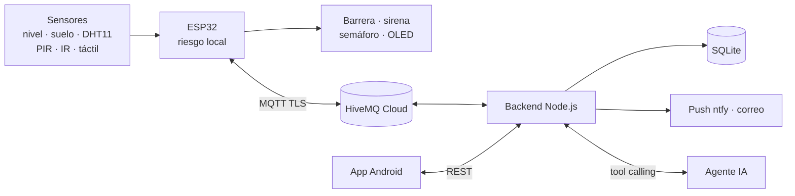

<div align="center">

# Centinela Cravo Sur

**Sistema IoT de alerta temprana de crecientes** · ESP32 + MQTT + App Android + Agente IA

Mide el nivel del río y **la velocidad a la que sube**, cierra el paso del puente, activa la sirena, avisa al celular y responde en lenguaje natural qué está pasando. Funciona aunque se caiga internet.

Proyecto formativo · **SENA – Tecnología en Análisis y Desarrollo de Software (ADSO)** · Yopal, Casanare, Colombia


[](https://github.com/SantiagoRicaurte06/Proyecto-ESP32-IoT/actions/workflows/firmware.yml)
[](https://github.com/SantiagoRicaurte06/Proyecto-ESP32-IoT/actions/workflows/backend.yml)
[](https://github.com/SantiagoRicaurte06/Proyecto-ESP32-IoT/actions/workflows/apk.yml)

</div>

---

## Cómo funciona

| Riesgo | Condición (maqueta) | La estación… | Notificación |
|---|---|---|---|
| 🟢 Verde | nivel < 5 cm | paso abierto | — |
| 🟡 Amarillo | ≥ 5 cm o ribera saturada | vigila | push |
| 🟠 Naranja | ≥ 8 cm | **cierra la barrera** | push + correo |
| 🔴 Rojo | ≥ 11 cm | **sirena** hasta que alguien la reconozca | push repetido + correo |

Si el agua sube a más de 2 cm/min, el riesgo sube un nivel extra. Además, el sistema avisa cuando:
- hay personas en la ribera durante una alerta,
- un vehículo intenta cruzar con la barrera cerrada,
- alguien presiona el botón comunitario,
- la estación se desconecta.

## Arquitectura



## Estructura

| Carpeta | Contenido |
|---|---|
| [`firmware/`](firmware/) | ESP32 (PlatformIO): medición, tasa de ascenso, máquina de estados, MQTT, respaldo sin conexión, OTA · simulación Wokwi |
| [`backend/`](backend/) | MQTT → SQLite, predicción de desborde, notificaciones, API REST, agente IA, simulador de la estación |
| [`app/`](app/) | App Android (Expo): monitor, historial, control, chat con el agente |
| [`hardware/`](hardware/) | Plano eléctrico, plano de la maqueta, tabla de conexiones y materiales |
| [`docs/`](docs/) | Ideas, documento del proyecto y guía de puesta en marcha |

## Documentación

1. [Fase 1: ideas y comparación](docs/01-ideas.md)
2. [Fase 2: documento del proyecto](docs/02-fase2.md) (problema, objetivos, arquitectura, MQTT, agente IA, plan)
3. [Puesta en marcha paso a paso](docs/03-puesta-en-marcha.md)
4. [Hardware: conexiones y maqueta](hardware/README.md)

## Inicio rápido (sin hardware)

```bash
git clone https://github.com/SantiagoRicaurte06/Proyecto-ESP32-IoT.git
cd Proyecto-ESP32-IoT/backend
npm install && cp .env.example .env   # completa MQTT, tokens y API key
npm start                             # terminal 1
npm run simular                       # terminal 2: estación simulada
```

Instala el APK (pestaña **Actions → APK Android → Artifacts**), configura `http://<IP-del-PC>:3000` y el token, y verás la creciente simulada en tiempo real.

## Flujo de trabajo

[`GIT_WORKFLOW.md`](GIT_WORKFLOW.md): Git Flow simplificado (`main` / `develop` / `feature/*`), Conventional Commits y PRs con plantilla. Activa los hooks con `git config core.hooksPath .githooks`.

## Autor

**Santiago Alexis Ricaurte Piñeros** · [@SantiagoRicaurte06](https://github.com/SantiagoRicaurte06)

## Licencia

[MIT](LICENSE)
