# Fase 2 — Centinela Cravo Sur

Sistema de alerta temprana de crecientes con ESP32, MQTT, app Android y agente de IA.
Proyecto formativo SENA · Tecnología en ADSO · Yopal, Casanare.

---

## 1. Planteamiento del problema

En temporada de lluvias (abril–noviembre), el río Cravo Sur y las quebradas que atraviesan Yopal pueden crecer en pocas horas. Las familias de la ribera y los conductores que cruzan puentes y vados suelen enterarse cuando el agua ya está encima. Hoy no tienen un dato confiable y oportuno de **cuánto sube el agua ni a qué velocidad**.

Las estaciones hidrológicas oficiales son pocas, costosas y no avisan directamente a la comunidad. Las alertas dependen de que alguien observe el río y avise por teléfono, y no queda registro de los eventos para aprender de ellos.

**Pregunta problema:** ¿cómo alertar a tiempo a la comunidad y a gestión del riesgo sobre una creciente, con un sistema de bajo costo que actúe solo aun sin internet y permita consultar lo ocurrido?

## 2. Justificación

- **Social:** protege vidas y bienes en zonas ribereñas. El semáforo y la barrera actúan en sitio, mientras las alertas al celular llegan a quien no está cerca. El agente IA permite que cualquier persona pregunte en lenguaje natural sin saber leer gráficas.
- **Técnica:** integra IoT (ESP32 con sensores y actuadores), comunicación MQTT con TLS, procesamiento en el borde (filtro, regresión, máquina de estados con histéresis), persistencia de series de tiempo, API REST, app móvil y un agente de IA con *tool calling*. Cubre las competencias del programa ADSO de punta a punta.
- **Económica:** usa hardware que ya está disponible (costo adicional ≈ $30.000 COP) y servicios con capa gratuita (HiveMQ Cloud, ntfy, GitHub Actions). Una estación comercial cuesta millones de pesos. El diseño es replicable en cada puente o vado.

## 3. Objetivos

**Objetivo general.** Desarrollar un sistema IoT de alerta temprana de crecientes basado en ESP32 que mida el nivel y la velocidad de ascenso del agua y active alertas locales y remotas. El sistema permitirá consultar el histórico mediante una aplicación Android con un agente de inteligencia artificial.

**Objetivos específicos.**
1. Implementar en el ESP32 la medición del nivel del agua, la tasa de ascenso y las variables ambientales, con una máquina de estados de riesgo que opere sin conexión a internet.
2. Integrar la estación con un broker MQTT seguro y un backend que almacene el histórico y envíe notificaciones push y por correo según el nivel de alerta.
3. Construir una aplicación Android que muestre el estado en tiempo real, el histórico y los eventos, y permita al operador controlar la barrera y reconocer alertas.
4. Diseñar un agente de IA que responda preguntas en lenguaje natural sobre las métricas consultando la base de datos mediante herramientas.
5. Validar el sistema en una maqueta a escala que simule una creciente real ante el jurado.

## 4. Planteamiento de la solución

Una estación instalada en el puente mide cada 0,5 s la distancia al agua (HC-SR04) y la humedad del suelo de la ribera. Calcula la **tasa de ascenso** con regresión lineal sobre los últimos 30 s y clasifica el riesgo:

| Nivel | Condición (maqueta) | Acción automática |
|---|---|---|
| Verde | nivel < 5 cm | LED verde fijo, paso abierto |
| Amarillo | ≥ 5 cm, o suelo saturado ≥ 80 % | LED verde intermitente, push de vigilancia |
| Naranja | ≥ 8 cm | **Barrera cerrada**, push + correo |
| Rojo | ≥ 11 cm | Barrera cerrada y **LED rojo intermitente** hasta que alguien reconozca la alerta, push prioritario repetido cada 2 min + correo |

Si el agua sube a más de 2 cm/min, el riesgo sube un nivel extra. Para bajar de nivel, el agua debe estar 1 cm por debajo del umbral durante 10 s (histéresis), así el semáforo no parpadea en el límite.

Toda la lógica de seguridad corre **en el ESP32**. Si se cae el WiFi, la estación sigue cerrando la barrera y encendiendo el LED rojo, guarda las lecturas en memoria y las envía al reconectar. El backend recibe todo por MQTT, lo guarda en SQLite, predice el **tiempo hasta el desbordamiento** y notifica. La app muestra el estado cada 2 s, y el agente IA responde preguntas consultando la base de datos.

## 5. Arquitectura del sistema

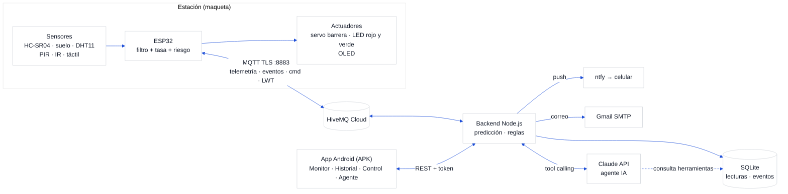

| Capa | Tecnología | Por qué |
|---|---|---|
| Dispositivo | ESP32 + Arduino (PlatformIO) | WiFi integrado, ADC, PWM; librerías maduras |
| Mensajería | MQTT sobre TLS (HiveMQ Cloud, gratis) | Liviano, QoS, *retained* y *Last Will* para saber si la estación cayó |
| Backend | Node.js 22+ (sin framework), `mqtt`, `node:sqlite` | Cero dependencias nativas, corre en cualquier PC |
| Base de datos | SQLite (WAL) con índices por tiempo | Archivo único, suficiente para series de una estación |
| Notificaciones | ntfy (push) + Gmail (correo) | ntfy no requiere cuenta ni Firebase |
| App | React Native + Expo (SDK 58), APK compilado en GitHub Actions | Un solo lenguaje (JS) con el backend; APK sin instalar Android Studio |
| IA | Claude (`claude-opus-5-5`) con *tool calling* | Responde con datos reales consultando herramientas, no inventa cifras |

## 6. Tabla de conexiones

Ver [`hardware/README.md`](../hardware/README.md#tabla-de-conexiones) (componente, pin, GPIO, voltaje y notas). Resumen:

| GPIO | Componente | | GPIO | Componente |
|---|---|---|---|---|
| 5 / 18 | HC-SR04 TRIG / ECHO (divisor) | | 13 | Servo SG90 |
| 34 | Humedad de suelo (ADC1) | | | |
| 4 | DHT11 | | 19 / 25 | LED verde / rojo |
| 27 | PIR | | 21 / 22 | OLED SDA / SCL |
| 26 | IR obstáculos | | 32 / 14 | Joystick (opcional) |
| 33 | Táctil | | | |

## 7. Plano eléctrico

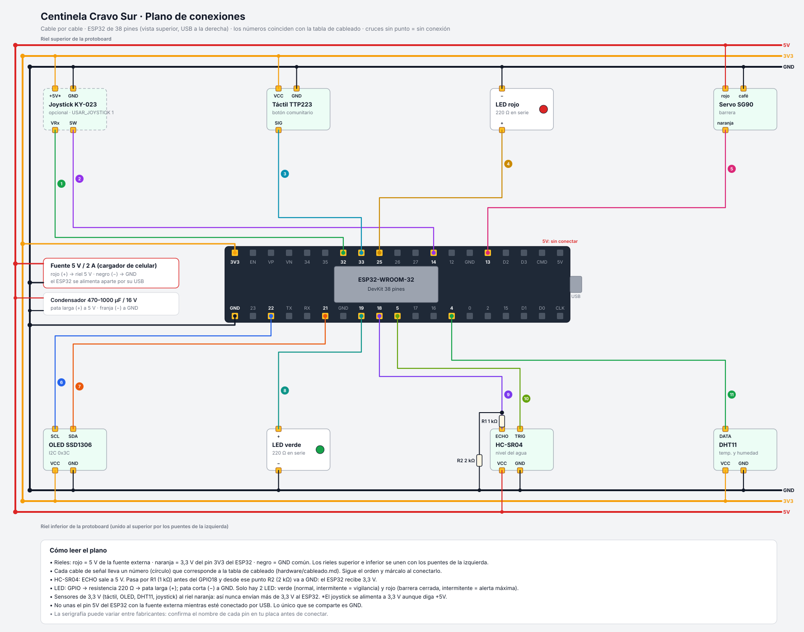

Cable por cable, con casillas para marcar: [`hardware/cableado.md`](../hardware/cableado.md). Resumen por pin: [`hardware/plano-electrico.svg`](../hardware/plano-electrico.svg).

Simulación: [`firmware/diagram.json`](../firmware/diagram.json) para Wokwi (en VS Code). El potenciómetro hace de sensor de suelo y los pulsadores hacen de IR y táctil.

## 8. Plano de la maqueta

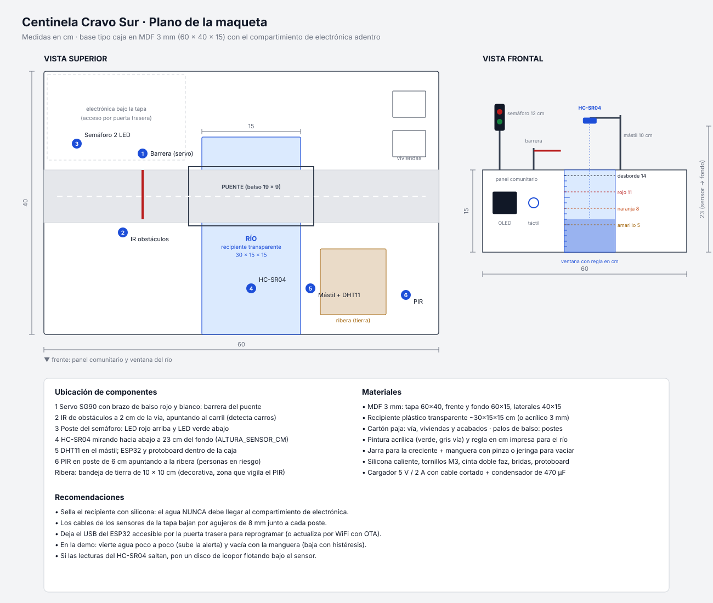

**Armado paso a paso (render en Blender):** [`hardware/maqueta-3d.html`](../hardware/maqueta-3d.html) · video para la presentación: [`armado-con-titulos.mp4`](../hardware/blender/armado-con-titulos.mp4) · imágenes por paso: [`hardware/blender/pasos/`](../hardware/blender/pasos/).

| | | | |
|---|---|---|---|
| 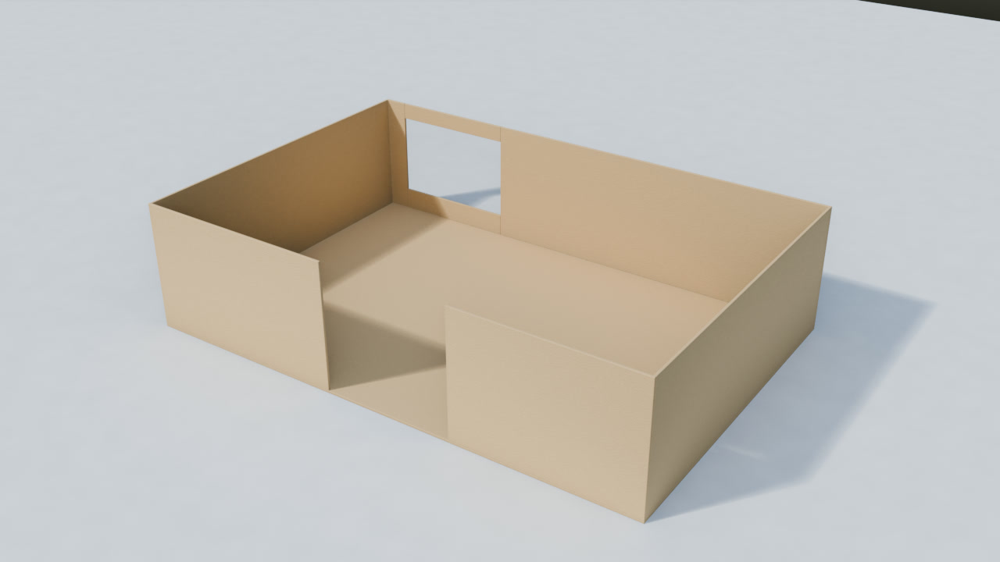 |  | 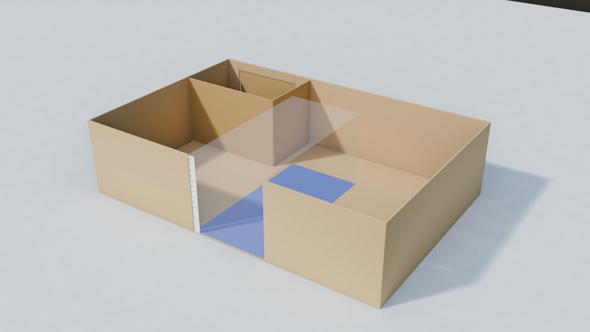 | 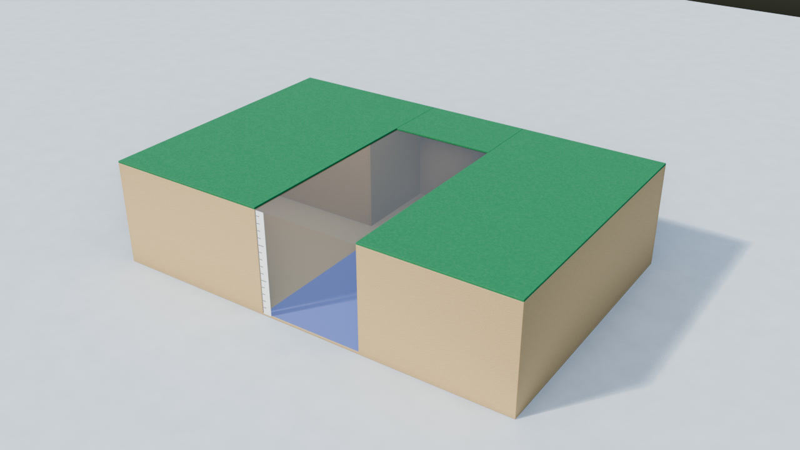 |
| 1. Caja | 2. Electrónica | 3. Río | 4. Tapa |
| 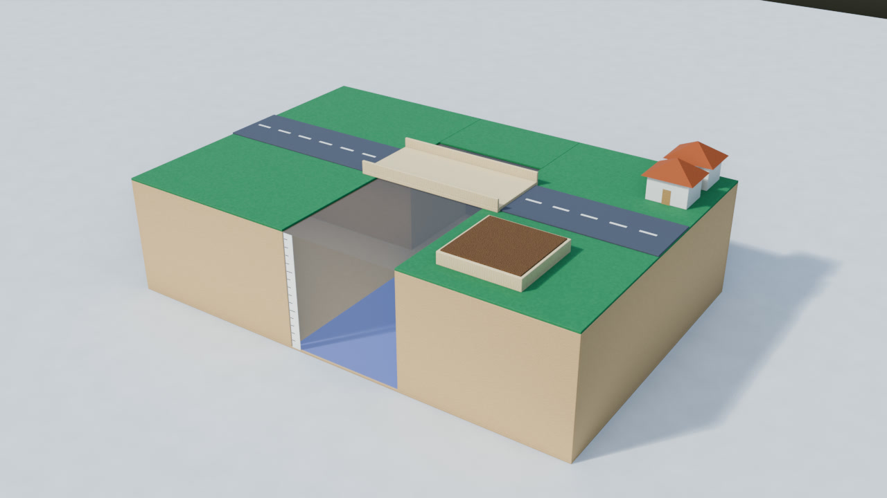 | 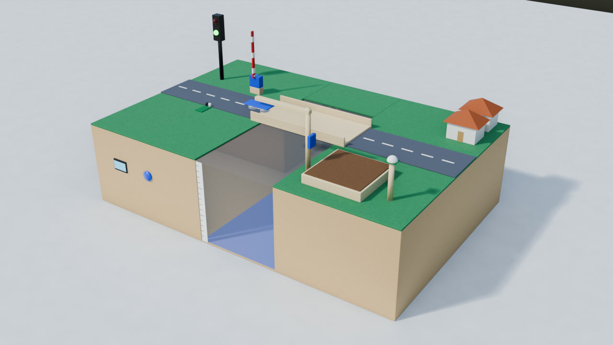 | 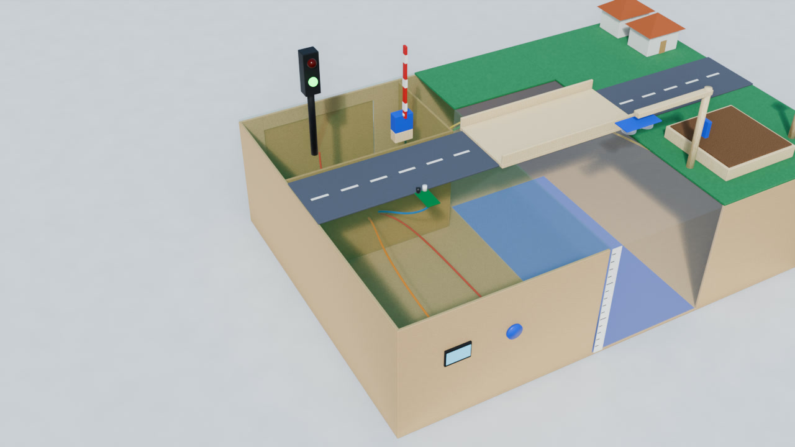 | 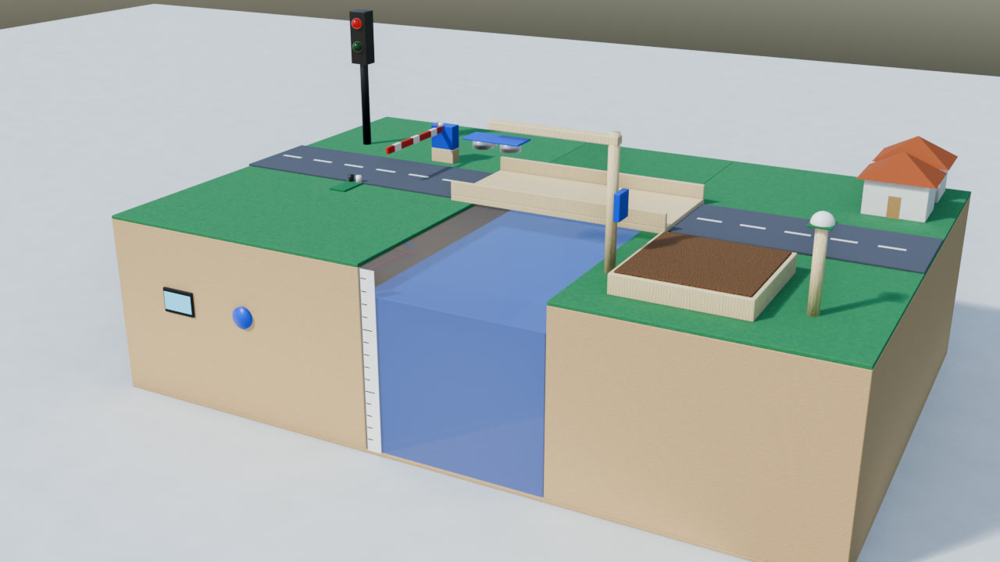 |
| 5. Vía y ribera | 6. Sensores | 7. Cableado | 8. Prueba con agua |

- **Base:** caja de MDF 3 mm de 60 × 40 × 15 cm. Adentro, el compartimiento de electrónica, con acceso por una puerta trasera.
- **Río:** recipiente transparente de 30 × 15 × 15 cm empotrado en la tapa, con una ventana frontal y una regla en cm. El desborde está a 14 cm.
- **Sobre la tapa:**
  - Vía con puente de balso.
  - Barrera con el servo.
  - Sensor IR en el carril.
  - Semáforo de 12 cm con LED rojo y LED verde.
  - Mástil de 10 cm con el brazo del HC-SR04 sobre el río (a 23 cm del fondo) y el DHT11.
  - Bandeja de tierra (ribera) con el sensor de humedad.
  - PIR apuntando a la ribera.
  - Viviendas decorativas.
- **Frente:** panel comunitario con la OLED y el botón táctil.

## 9. Topics MQTT y mensajes

Base: `centinela/est01`

| Topic | Dirección | QoS / retained | Frecuencia |
|---|---|---|---|
| `centinela/est01/telemetria` | ESP32 → | 0 | cada 2 s (cada 10 s en respaldo sin conexión) |
| `centinela/est01/evento` | ESP32 → | 0 (nunca se descartan: se encolan) | cuando ocurre |
| `centinela/est01/estado` | ESP32 → | 1 / **retained** · **LWT** | al conectar; `{"online":false}` si cae |
| `centinela/est01/cmd` | Backend → ESP32 | 1 | a demanda del operador |

**Telemetría**
```json
{ "ts": 1794342525, "nivel": 7.1, "dist": 15.9, "tasa": 3.99, "suelo": 73, "temp": 29.9, "hum": 77,
  "riesgo": "naranja", "barrera": "cerrada", "alarma": false, "modo": "auto", "reconocida": false,
  "pir": false, "ir": false, "rssi": -55 }
```

**Eventos** (todos llevan `tipo`, `ts`, `riesgo`, `nivel`)
```json
{ "tipo": "cambio_riesgo", "de": "amarillo", "a": "naranja", "tasa": 6.34, "suelo": 68, "ts": 1794342506, "riesgo": "naranja", "nivel": 5.1 }
{ "tipo": "persona_zona", ... }        { "tipo": "vehiculo_barrera", ... }
{ "tipo": "boton_emergencia", "origen": "tactil", ... }
{ "tipo": "alerta_reconocida", "origen": "app" | "tactil", ... }
{ "tipo": "comando", "accion": "barrera", "modo": "manual", ... }
{ "tipo": "arranque", "fw": "1.0.0", ... }
```

**Estado (retained)**
```json
{ "online": true, "fw": "1.0.0", "ip": "192.168.1.40", "umbrales": { "amarillo": 5, "naranja": 8, "rojo": 11 }, "desborde": 14 }
```

**Comandos**
```json
{ "accion": "barrera", "valor": "cerrar" | "abrir" }      // pasa a modo manual
{ "accion": "modo",    "valor": "auto" | "manual" }
{ "accion": "reconocer" }                                 // el LED rojo queda fijo y la alerta deja de repetirse
{ "accion": "umbrales", "valor": { "amarillo": 5, "naranja": 8, "rojo": 11 } }
```

**Seguridad:** TLS en el puerto 8883, con usuarios distintos en HiveMQ para el ESP32 y para el backend. La app **no** se conecta al broker: pasa por el backend con token, y el backend valida cada comando contra una lista permitida.

## 10. Stack de la app, backend y base de datos

**App Android** (`app/`): React Native + Expo SDK 58.

| Pantalla | Qué muestra |
|---|---|
| Monitor | Tarjeta de riesgo con color y consejo de seguridad, tubo de nivel, tasa, **tiempo estimado al desborde**, sensores, actuadores y estado de conexión. Actualiza cada 2 s |
| Historial | Gráfica del nivel (15 min a 24 h) con las líneas de umbral y la lista de eventos |
| Agente IA | Chat con preguntas sugeridas |
| Control | Solo operador: modo auto/manual, barrera, reconocer alerta y umbrales |
| Ajustes | URL del backend, token (comunidad u operador), guía de ntfy |

El APK se compila en **GitHub Actions** (`.github/workflows/apk.yml`) y se descarga como artefacto.

**Backend** (`backend/`): Node.js. API REST:

| Método y ruta | Rol | Uso |
|---|---|---|
| `GET /api/salud` | público | broker y estación conectados |
| `GET /api/sesion` | token | rol del token |
| `GET /api/estado` | comunidad | última telemetría, estación, predicción |
| `GET /api/historial?minutos=60` | comunidad | serie reducida a 120 puntos |
| `GET /api/eventos?limite=30` | comunidad | últimos eventos |
| `POST /api/comando` | **operador** | `{accion, valor}` validado → MQTT |
| `POST /api/agente` | comunidad | `{historial:[{rol, texto}]}` → respuesta del agente (máx. 12/min por IP) |

**Base de datos** (SQLite): `lecturas(ts, nivel, tasa, suelo, temp, hum, riesgo, barrera, alarma, modo, pir, ir)` con índice en `ts`; `eventos(id, ts, tipo, riesgo, nivel, datos JSON)` con índices `ts` y `(tipo, ts)`; `notificaciones(...)` como registro de envíos.

## 11. Agente IA

- **Modelo:** Claude (`claude-opus-5-5`) vía API de Anthropic, con esfuerzo `low` para responder rápido. Si el modelo declina una solicitud, el backend activa un modelo de respaldo (*fallback* del servidor). La API key vive solo en el backend, nunca en el APK.
- **Cómo consulta las métricas:** *tool calling*. El modelo no ve la base de datos: pide herramientas, el backend ejecuta consultas SQL parametrizadas y le devuelve JSON. Así responde con cifras reales y no inventa datos.

| Herramienta | Devuelve |
|---|---|
| `estado_actual` | Última lectura, en línea, umbrales |
| `estadisticas(variable, desde, hasta)` | min, max, promedio, muestras, hora del pico |
| `contar_eventos(tipo?, desde, hasta)` | Conteo por tipo |
| `listar_eventos(tipo?, desde, hasta, limite)` | Detalle de eventos |
| `tiempo_por_riesgo(desde, hasta)` | Minutos en verde/amarillo/naranja/rojo |
| `serie_nivel(desde, hasta, puntos)` | Tendencia del nivel |
| `prediccion_desborde` | Tasa, tendencia, minutos al desborde, confianza R² |

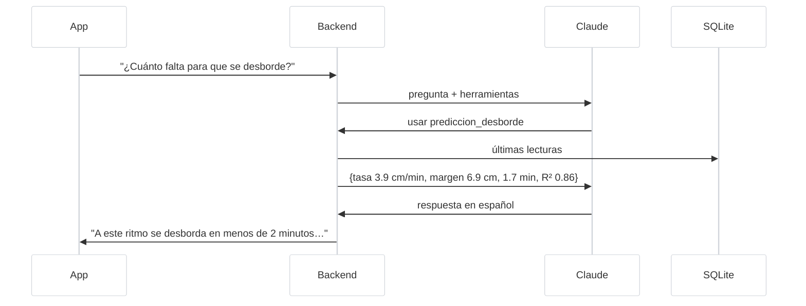

**Ejemplos**

| Pregunta | Herramientas | Respuesta esperada |
|---|---|---|
| ¿Cómo está el río ahora? | `estado_actual`, `prediccion_desborde` | "Alerta naranja: el agua está en 7,1 cm y sube 4 cm/min; la barrera está cerrada. A este ritmo se desborda en unos 2 minutos. Aléjese de la ribera." |
| ¿Cuántas alertas hubo hoy? | `contar_eventos` | "Hoy hubo 3 cambios de alerta: a amarillo a las 3:28 p. m., a naranja a las 3:28 p. m. y a rojo a las 3:29 p. m." |
| ¿Cuál fue el nivel máximo hoy y a qué hora? | `estadisticas(nivel)` | "El máximo fue 12,6 cm a las 3:30 p. m." |
| ¿Cuánto tiempo estuvimos en rojo? | `tiempo_por_riesgo` | "1,2 minutos en rojo, 2,1 en naranja y 0,8 en amarillo." |
| ¿Alguien intentó cruzar el puente cerrado? | `contar_eventos(vehiculo_barrera)` | "Sí, 2 vehículos, a las 3:29 y 3:30 p. m." |
| Genera el reporte del último evento | `listar_eventos`, `serie_nivel`, `tiempo_por_riesgo` | Reporte con inicio, pico, duración por nivel y acciones (barrera, LED de alerta, reconocimiento) |

## 12. Plan de trabajo (2 días) y materiales

El software ya está escrito y probado. Esto es lo que queda:

**Día 1 — Hardware y maqueta**

| Hora | Tarea | Responsable |
|---|---|---|
| 1 h | Crear cuentas: HiveMQ Cloud (cluster + 2 usuarios), clave de Anthropic, app ntfy en el celular | |
| 1 h | Simular en Wokwi y probar el backend + simulador + app (sin hardware) — ver [puesta en marcha](03-puesta-en-marcha.md) | |
| 3 h | Cortar y armar la caja de MDF, empotrar y sellar el recipiente, pintar | |
| 2 h | Cablear en la protoboard según el plano, subir firmware y calibrar (`ALTURA_SENSOR_CM`, suelo seco/mojado, ángulos del servo) | |
| 1 h | Montar postes, mástil, barrera, semáforo, ribera; pasar cables | |

**Día 2 — Integración y sustentación**

| Hora | Tarea |
|---|---|
| 1 h | Descargar el APK de GitHub Actions, instalarlo y configurar la URL y el token |
| 2 h | Pruebas completas: creciente real con agua, alertas en ntfy y correo, control desde la app, prueba sin WiFi (desconectar el router) |
| 1 h | Llenar el histórico con 2–3 crecientes de prueba para que el agente tenga datos |
| 2 h | Presentación y ensayo del guion de la demo |

**Guion de la demo (5 min)**
1. Estado verde: mostrar la app y la OLED.
2. Verter agua: sube a amarillo y llega el push.
3. Seguir vertiendo: naranja. La barrera baja, llegan push y correo, y la app muestra el tiempo estimado al desborde.
4. Rojo: el LED rojo parpadea. Pasar un carrito por el IR (alerta de vehículo) y reconocer la alerta con el táctil (el LED queda fijo).
5. Desconectar el WiFi del ESP32: la estación sigue funcionando y llega "estación desconectada". Reconectar y mostrar que el respaldo se envió.
6. Vaciar con la manguera: baja con histéresis a verde.
7. Preguntar al agente: "¿Qué pasó en el último evento?" y "¿Cuánto tiempo estuvimos en rojo?".

**Materiales:** ver [`hardware/README.md`](../hardware/README.md#lista-de-materiales) (costo adicional ≈ $25.000–33.000 COP).
