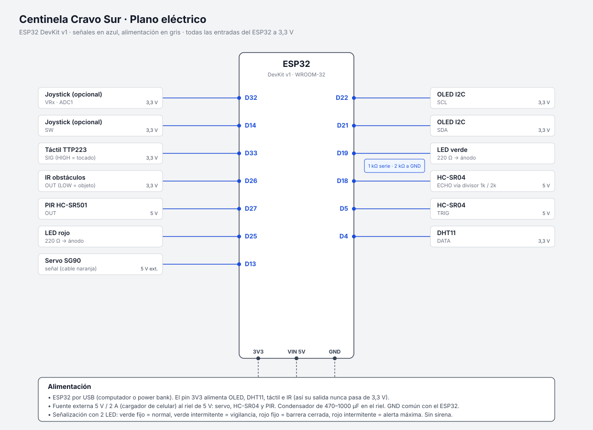

# Hardware · Centinela Cravo Sur

| Archivo | Contenido |
|---|---|
| [`plano-electrico.svg`](plano-electrico.svg) | Conexiones de cada componente al ESP32 y alimentación |
| [`maqueta.svg`](maqueta.svg) | Vista superior y frontal con medidas, ubicación de componentes y materiales |
| [`maqueta-3d.html`](maqueta-3d.html) | **Modelo 3D interactivo** (Three.js): armado en 7 pasos, medidas de cada pieza, lista de corte, vista por dentro y simulación de la creciente. Ábrelo con doble clic en el navegador |
| [`../firmware/diagram.json`](../firmware/diagram.json) | Circuito para simular en **Wokwi** (VS Code) |



## Tabla de conexiones

| Componente | Pin del componente | GPIO ESP32 | Alimentación | Notas |
|---|---|---|---|---|
| HC-SR04 | VCC / GND | — | 5 V (riel externo) | |
| | TRIG | **GPIO5** | | |
| | ECHO | **GPIO18** | | **Divisor**: ECHO → 1 kΩ → GPIO18; GPIO18 → 2 kΩ → GND (5 V → 3,3 V) |
| Humedad de suelo | VCC / GND | — | **3,3 V** | Con 3,3 V la salida AO nunca pasa de 3,3 V |
| | AO | **GPIO34** | | ADC1 (funciona con WiFi). Solo entrada |
| DHT11 | VCC / GND | — | 3,3 V | |
| | DATA | **GPIO4** | | Resistencia de 10 kΩ a 3,3 V si el módulo no la trae |
| PIR HC-SR501 | VCC / GND | — | 5 V | Salida de 3,3 V: va directo |
| | OUT | **GPIO27** | | Ajusta el potenciómetro de tiempo al mínimo |
| IR obstáculos | VCC / GND | — | 3,3 V | |
| | OUT | **GPIO26** | | LOW = obstáculo |
| Táctil TTP223 | VCC / GND | — | 3,3 V | |
| | SIG | **GPIO33** | | HIGH = tocado |
| Servo SG90 | Rojo / Café | — | 5 V (riel externo) | Condensador de 470 µF en el riel |
| | Naranja (señal) | **GPIO13** | | |
| Relé 1 canal | VCC / GND | — | 5 V (riel externo) | |
| | IN | **GPIO23** | | Activo en BAJO por defecto (`RELE_ACTIVO_EN_ALTO`) |
| | COM / NO | — | 5 V → buzzer o baliza | La "sirena" de la maqueta |
| LED verde | Ánodo (+) | **GPIO19** | | 220 Ω en serie; cátodo a GND |
| LED amarillo | Ánodo (+) | **GPIO17** | | 220 Ω |
| LED naranja | Ánodo (+) | **GPIO16** | | 220 Ω (si no tienes naranja, usa otro amarillo o uno blanco) |
| LED rojo | Ánodo (+) | **GPIO25** | | 220 Ω |
| OLED I2C (SSD1306) | VCC / GND | — | 3,3 V | Dirección 0x3C |
| | SDA / SCL | **GPIO21 / GPIO22** | | |
| Joystick KY-023 (opcional) | VRx / SW | GPIO32 / GPIO14 | 3,3 V | Cambia pantallas de la OLED. Activa `USAR_JOYSTICK 1` |

**GPIO usados: 17** de ~25 disponibles. No se usan los pines de arranque (0, 2, 12, 15) ni los de la flash (6–11).

**Descartados**: matriz LED 8x8 sin driver (16 GPIO) y display de 4 dígitos sin driver (12 GPIO): no caben con el resto y exigen multiplexado constante que compite con WiFi y MQTT. LCD 16x2: la OLED cumple la misma función con 2 pines.

## Alimentación

```
Cargador 5 V / 2 A ──┬── riel +5 V ── servo, relé, HC-SR04, PIR
                     │   (470–1000 µF entre +5 V y GND)
                     └── riel GND ──┬── GND del ESP32  ← GND COMÚN obligatorio
USB (PC o power bank) ── ESP32 ── 3V3 ── OLED, DHT11, táctil, IR, humedad de suelo
```

- No alimentes el servo desde el pin 3V3. Desde VIN solo sirve para pruebas cortas: el pico de corriente del servo reinicia el ESP32.
- Con el relé solo se conmuta un buzzer o una baliza de 5 V. **No conectes 110 V** en la maqueta.

## Lista de materiales

| Ítem | Cant. | Estado | Costo aprox. (COP) |
|---|---|---|---|
| ESP32 DevKit v1 | 1 | disponible | — |
| HC-SR04, DHT11, PIR, humedad de suelo, IR, táctil | 1 c/u | disponible | — |
| Servo SG90, relé 1 canal, OLED I2C | 1 c/u | disponible | — |
| LEDs (verde, amarillo, naranja, rojo) + resistencias 220 Ω | 4 | disponible | — |
| Resistencias 1 kΩ y 2 kΩ (divisor) | 1 c/u | conseguir | 200 |
| Condensador electrolítico 470–1000 µF / 16 V | 1 | conseguir | 1.000 |
| Buzzer activo 5 V (sirena) | 1 | conseguir | 2.000 |
| Protoboard + cables dupont | 1 | disponible | — |
| Cargador de celular 5 V / 2 A (cable cortado o módulo USB) | 1 | reciclado | 0 |
| MDF 3 mm (60×40 + laterales) | 1 lámina | conseguir | 12.000 |
| Recipiente plástico transparente ~30×15×15 cm | 1 | reciclado | 0–8.000 |
| Palos de balso, cartón paja, pintura, silicona | — | conseguir | 10.000 |
| **Total adicional** | | | **≈ 25.000–33.000** |
